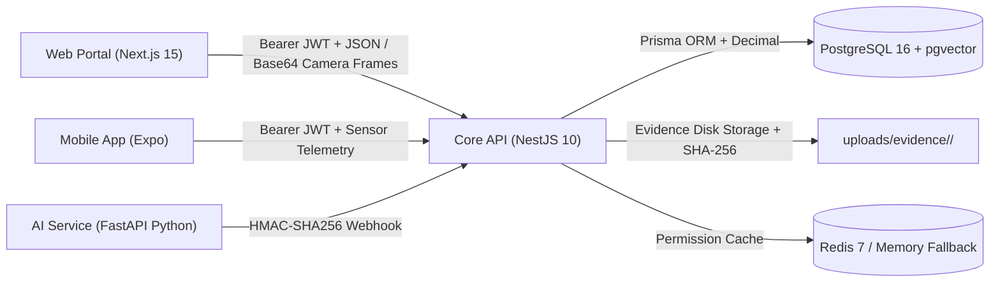
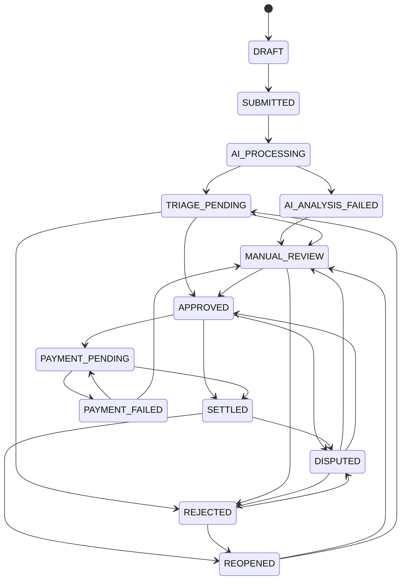
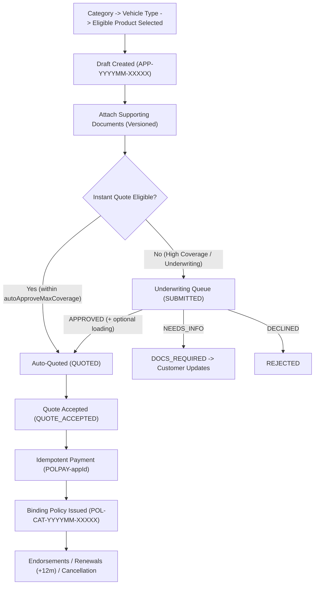

# OmniClaim Enterprise Architecture

## 1. High-Level System Architecture

---

## 2. Security, Authentication & Access Control

- **Strict Bearer JWT Authentication** (`DynamicPermissionsGuard` + `CurrentUser`): Protected routes require a valid HS256-signed Bearer JWT (`JWT_SECRET`). Unauthenticated or header-spoofed requests (`x-user-id` without JWT) are rejected with `401 Unauthorized`.
- **No Direct Role Switching or Impersonation**: Client-side role dropdown switching, navbar account-switch shortcuts, and server-side `/auth/impersonate/:userId` endpoints have been removed. Switching accounts requires signing out and authenticating explicitly via `POST /api/v1/auth/login`.
- **Unique Username + Common Initial Password Onboarding**:
  - When an administrator creates a user under a role via `POST /api/v1/super-admin/users`, `SuperAdminService` guarantees a unique `username` (auto-generating from `roleSlug + fullName` and appending random 4-digit suffixes on collisions), hashes `DEFAULT_USER_PASSWORD` (`OmniClaim@123` unless specified) using PBKDF2-SHA512, and sets `mustChangePassword: true`.
  - When the user signs in, `mustChangePassword` triggers the **Change Password** modal in `AppShell`, calling `POST /api/v1/auth/change-password` to verify their current password, store their personal password hash, and clear `mustChangePassword` to `false`.
- **Refresh Token Rotation & Reuse Detection** (`RefreshToken` table): `POST /api/v1/auth/login` issues a 24h JWT `accessToken` and a 7-day opaque `refreshToken` stored as a SHA-256 hash. Rotating via `POST /api/v1/auth/refresh` invalidates the previous token; re-presenting a revoked token revokes all active tokens for that user.
- **Row-Level Policyholder Scoping**:
  - `GET /api/v1/super-admin/bootstrap`, `GET /api/v1/claims`, `GET /api/v1/claims/:id`, `GET /api/v1/claims/:id/evidence/:evidenceId/file`, `GET /api/v1/policy-applications`, `GET /api/v1/policy-applications/:id`, and `GET /api/v1/policies` restrict `POLICYHOLDER` accounts strictly to their own policies, claims, evidence, and applications.
- **Separation of Duties**:
  - Claim approval requires `claims:approve`; financial settlement disbursement requires both `claims:settle` and `ledger:post`.
  - AI / Straight-Through Processing (`StpRuleEngineService`) produces advisory recommendations (`STP_RECOMMENDED` / `MANUAL_REVIEW`) and never directly authorizes or posts payments.
- **Webhook Security**: `/api/v1/webhooks/ai-completion` enforces timing-safe HMAC-SHA256 signature verification (`x-omniclaim-signature`) in all environments.

---

## 3. Live Camera Evidence Capture Pipeline

- **Client UI (`LiveCameraCapture`)**: Guides users sequentially through 7 steps (`FRONT`, `REAR`, `LEFT_SIDE`, `RIGHT_SIDE`, `DAMAGE_CLOSEUP`, `NUMBER_PLATE`, `ADDITIONAL`) via `navigator.mediaDevices.getUserMedia` with overlay framing guides, client-side brightness/sharpness heuristics, retake preview, and per-photo upload feedback. Gallery `<input type="file">` controls are excluded for customer capture. *(Staff holding `claims:update` can separately attach verified exception documents with a mandatory audit reason.)*
- **Server Validation & Storage (`ClaimsService`)**:
  - `Main` configures a 15 MB Express body limit (`NestExpressApplication.useBodyParser`).
  - Validates JPEG/PNG/WEBP headers using real image magic bytes (max 8 MB decoded), computes SHA-256 checksums (`checksumSha256`), writes files under `apps/api/uploads/evidence/<claimId>/<uuid>.<ext>`, records server upload timestamp (`serverUploadedAt`) and authenticated `uploadedById`, and creates `ClaimAuditLog` entries.
  - Access-controlled retrieval (`GET /api/v1/claims/:id/evidence/:evidenceId/file`) streams images with customer ownership enforcement.

---

## 4. Navigation Structure (`Sidebar`)

The left navigation rail groups routes into two permission-filtered sections:
- **Operations**: Apply for Policy → My Policies → Underwriting Review → Claims (`All Claims`, `File a Claim`) → Fraud Review → Payments & Ledger.
- **Administration** (visible only when authorized): **Master Setup** collapsible dropdown (`Users`, `Roles & Rights`, `Policy Categories`, `Vehicle Types`, `Policy Products`, `Repair Garages`, `Parts Catalog`) → Team & Access → Activity & Audit.

---

## 5. Claim Finite State Machine (FSM)

Every status change in `ClaimFsmService` executes inside a database transaction with Optimistic Concurrency Control (`version` increment check) and writes an immutable `ClaimTransitionLog` entry.

---

## 6. Policy Application & Issuance Flow (`Category → Vehicle Type → Product`)

---

## 7. Financial, Actuarial & Audit Invariants

- **Double-Entry Zero-Sum Ledger**: Every `LedgerJournalEntry` validates `sum(Debits) === sum(Credits)` using arbitrary-precision `Prisma.Decimal`.
- **Idempotent Disbursements & Payments**: Both claim settlements (`PaymentDisbursement`, default key `SETTLE-${claimId}`) and policy premium payments (`PolicyPayment`, default key `POLPAY-${applicationId}`) enforce unique `idempotencyKey` constraints so duplicate requests replay safely without double-posting.
- **Audit-Safe Journal Reversals**: `LedgerService.reverseJournalEntry` creates an equal-and-opposite contra journal entry (`reversalOfJournalId`) and marks the original entry `VOIDED`.
- **Global HTTP Request & Field-Diff Logging**: `AuditLoggingInterceptor` and `AuditFallbackMiddleware` record `GET`, `POST`, `PUT`, `PATCH`, and `DELETE` requests into `SystemActivityAuditLog`, tracking old values, new values, per-field diffs, redacting secrets/passwords, and recording actor username/IP/duration.
