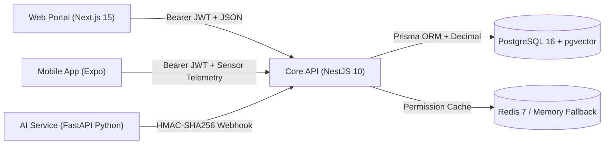
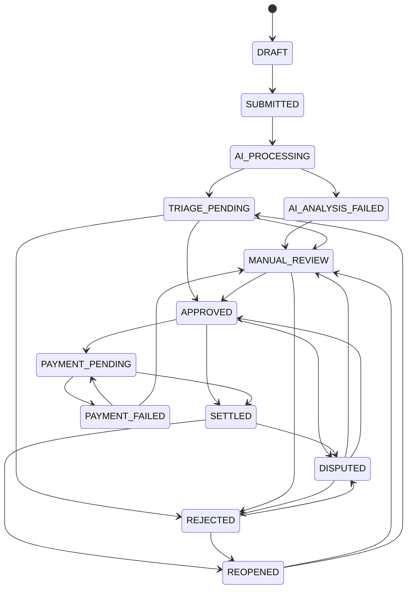
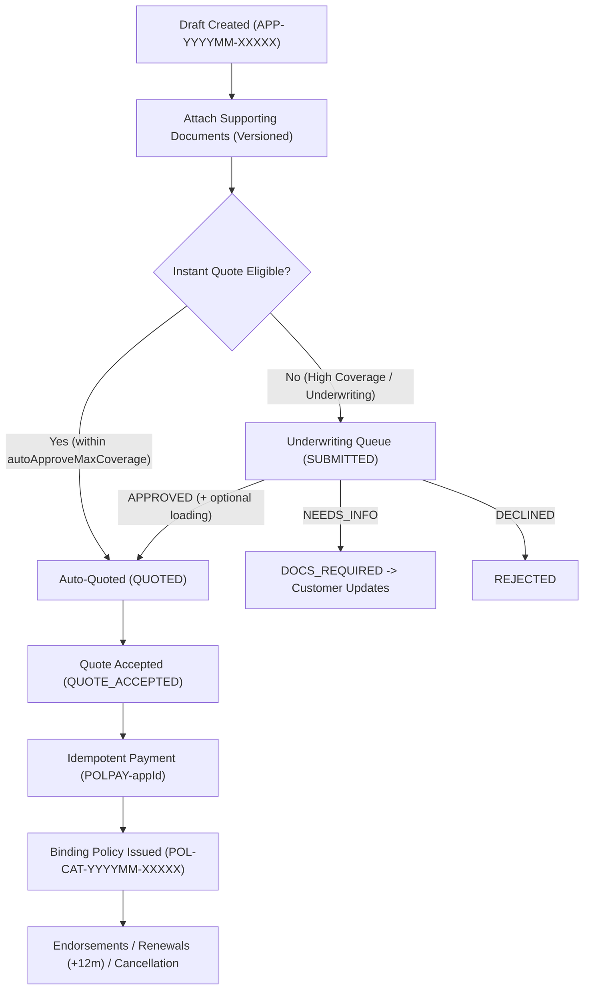

# OmniClaim Enterprise Architecture

## 1. High-Level System Architecture

---

## 2. Security & Access Control Controls

- **Strict Bearer JWT Authentication** (`DynamicPermissionsGuard` + `CurrentUser`): Requests to protected routes require a valid HS256-signed Bearer JWT (`JWT_SECRET`). Unauthenticated or spoofed header requests (`x-user-id` without JWT) are rejected with `401 Unauthorized`.
- **Refresh Token Rotation & Reuse Detection** (`RefreshToken` table): `POST /api/v1/auth/login` issues a 24h JWT `accessToken` and a 7-day opaque `refreshToken` stored as a SHA-256 hash. Rotating via `POST /api/v1/auth/refresh` invalidates the previous token; re-presenting a revoked token revokes all active tokens for that user.
- **Row-Level Policyholder Scoping**:
  - `GET /api/v1/super-admin/bootstrap`, `GET /api/v1/claims`, `GET /api/v1/claims/:id`, `GET /api/v1/policy-applications`, `GET /api/v1/policy-applications/:id`, and `GET /api/v1/policies` restrict `POLICYHOLDER` accounts strictly to their own policies, claims, and applications.
- **Separation of Duties**:
  - Claim approval requires `claims:approve`; financial settlement disbursement requires both `claims:settle` and `ledger:post`.
  - AI / Straight-Through Processing (`StpRuleEngineService`) produces advisory recommendations (`STP_RECOMMENDED` / `MANUAL_REVIEW`) and never directly authorizes or posts payments.
- **Webhook Security**: `/api/v1/webhooks/ai-completion` enforces timing-safe HMAC-SHA256 signature verification (`x-omniclaim-signature`) in all environments.

---

## 3. Claim Finite State Machine (FSM)

Every status change in `ClaimFsmService` executes inside a database transaction with Optimistic Concurrency Control (`version` increment check) and writes an immutable `ClaimTransitionLog` entry.

---

## 4. Policy Application & Issuance Flow

---

## 5. Financial, Actuarial & Audit Invariants

- **Double-Entry Zero-Sum Ledger**: Every `LedgerJournalEntry` validates `sum(Debits) === sum(Credits)` using arbitrary-precision `Prisma.Decimal`.
- **Idempotent Disbursements & Payments**: Both claim settlements (`PaymentDisbursement`, default key `SETTLE-${claimId}`) and policy premium payments (`PolicyPayment`, default key `POLPAY-${applicationId}`) enforce unique `idempotencyKey` constraints so duplicate requests replay safely without double-posting.
- **Audit-Safe Journal Reversals**: `LedgerService.reverseJournalEntry` creates an equal-and-opposite contra journal entry (`reversalOfJournalId`) and marks the original entry `VOIDED`.
- **Global HTTP Request & Field-Diff Logging**: `AuditLoggingInterceptor` and `AuditFallbackMiddleware` record `GET`, `POST`, `PUT`, `PATCH`, and `DELETE` requests into `SystemActivityAuditLog`, tracking old values, new values, per-field diffs, redacting secrets/passwords, and recording actor username/IP/duration.
